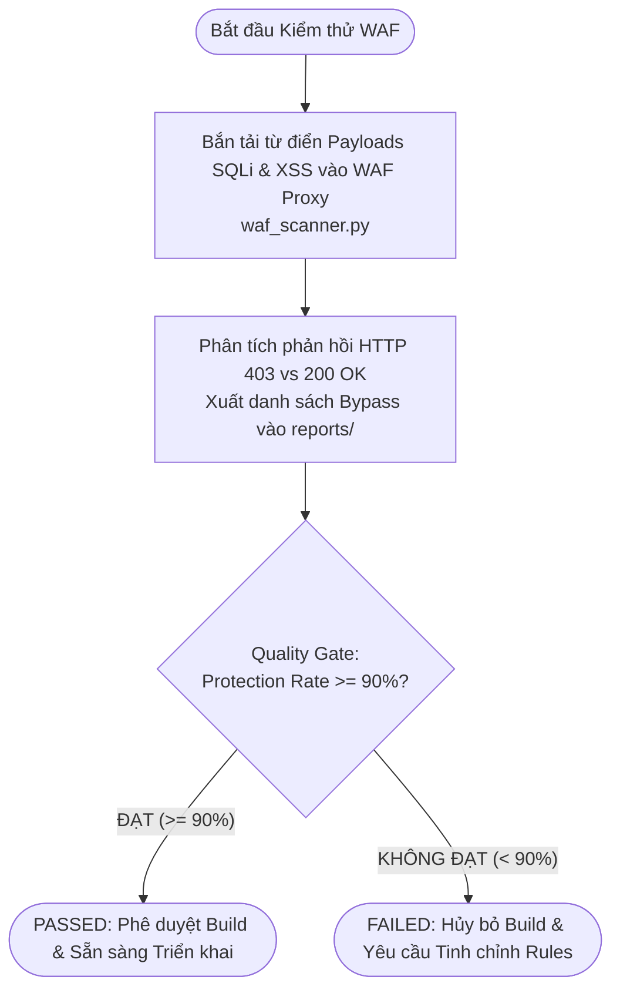

# 🛡️ WAF DEVSECOPS LAB & SOC AUTOMATED DEFENSE PLATFORM

[](https://www.docker.com/)
[](https://github.com/owasp-modsecurity/ModSecurity)
[](https://coreruleset.org/)
[](https://www.python.org/)
[](https://github.com/)
[](https://www.sqlite.org/)

Hệ thống phòng lab an ninh mạng toàn diện kết hợp **Tường lửa Ứng dụng Web (WAF - ModSecurity CRS)**, **Tự động hóa Phản ứng Sự cố An ninh (SOAR Bot 2 chiều qua Telegram)**, **Trung tâm Giám sát SOC Thời gian thực (Zero-Latency SQLite WAL Engine)**, và **Quy trình DevSecOps CI/CD Kiểm thử Bảo mật Tự động (SAST, SCA, DAST, Quality Gate >= 90%)**.

---

## 📑 MỤC LỤC
1. [Tổng Quan Dự Án](#1-tổng-quan-dự-án)
2. [Sơ Đồ Kiến Trúc Hệ Thống & Luồng Dữ Liệu](#2-sơ-đồ-kiến-trúc-hệ-thống--luồng-dữ-liệu)
3. [Chi Tiết Chuyên Sâu Từng Thành Phần](#3-chi-tiết-chuyên-sâu-từng-thành-phần)
   - [3.1. WAF Reverse Proxy (ModSecurity + OWASP CRS)](#31-waf-reverse-proxy-modsecurity--owasp-crs)
   - [3.2. Ứng Dụng Mục Tiêu (Web Target & MySQL Database)](#32-ứng-dụng-mục-tiêu-web-target--mysql-database)
   - [3.3. Real-time Log Parser & 2-Way Async SOAR Bot](#33-real-time-log-parser--2-way-async-soar-bot)
   - [3.4. SOC Monitoring Center Dashboard (SQLite WAL Engine)](#34-soc-monitoring-center-dashboard-sqlite-wal-engine)
   - [3.5. Quy Trình Tự Động Hóa DevSecOps CI/CD Pipeline](#35-quy-trình-tự-động-hóa-devsecops-cicd-pipeline)
4. [Cấu Trúc Thư Mục Dự Án](#4-cấu-trúc-thư-mục-dự-án)
5. [Hướng Dẫn Cài Đặt & Vận Hành Nhanh](#5-hướng-dẫn-cài-đặt--vận-hành-nhanh)
6. [Kịch Bản Thực Nghiệm & Kiểm Thử Phòng Lab](#6-kịch-bản-thực-nghiệm--kiểm-thử-phòng-lab)
7. [Chỉ Số Đo Lường & Công Thức Đánh Giá (Metrics)](#7-chỉ-số-đo-lường--công-thức-đánh-giá-metrics)
8. [Hướng Dẫn Xử Lý Sự Cố (Troubleshooting)](#8-hướng-dẫn-xử-lý-sự-cố-troubleshooting)
9. [Đóng Góp & Bản Quyền](#9-đóng-góp--bản-quyền)

---

## 1. TỔNG QUAN DỰ ÁN

### 1.1. Bối cảnh & Mục tiêu
Trong môi trường điện toán đám mây và kiến trúc Microservices hiện đại, việc bảo vệ các ứng dụng web không chỉ dừng lại ở việc áp dụng một lớp tường lửa tĩnh, mà đòi hỏi sự kết hợp chặt chẽ giữa:
1. **Khả năng nhận diện mối đe dọa chuyên sâu (Deep Threat Inspection):** Phân tích giao thức HTTP/HTTPS, chặn đứng các kiểu tấn công OWASP Top 10 phổ biến như SQL Injection, Cross-Site Scripting (XSS), Local/Remote File Inclusion (LFI/RFI).
2. **Khả năng phản ứng tự động (Active Response / SOAR):** Giảm thiểu thời gian phát hiện và xử lý (MTTD/MTTR) từ hàng giờ xuống dưới 1 giây mà không cần con người can thiệp thủ công vào CLI máy chủ.
3. **Khả năng hiển thị bức tranh toàn cảnh (Visibility & Observability):** Cung cấp giao diện trực quan cho SOC Analyst theo dõi chỉ số bảo mật thời gian thực mà không làm nghẽn I/O hệ thống.
4. **Tích hợp liên tục vòng đời phát triển an toàn (Shift-Left DevSecOps):** Tự động hóa kiểm thử tĩnh (SAST), kiểm thử thành phần phụ thuộc & cấu hình (SCA), và bắn tải đánh giá năng lực WAF (DAST) ngay trên Pipeline với Quality Gate rõ ràng.

### 1.2. Các Tính Năng Nổi Bật
- **ModSecurity v3 + OWASP Core Rule Set (CRS):** Thiết lập `PARANOIA=2`, chế độ chấm điểm bất thường inbound (`ANOMALY_INBOUND=5`) và outbound (`ANOMALY_OUTBOUND=4`).
- **SOAR Telegram Bot 2 chiều:** Nhận cảnh báo tức thời, tương tác qua nút bấm Inline Keyboard `[🚫 Chặn IP]`, `[🟢 Mở khóa (Unban)]`, và `[🔍 Tra cứu Threat Intel]`. Tự động áp dụng lệnh `deny <IP>;` vào Nginx và reload dịch vụ qua Docker Socket.
- **Cơ chế chống nghẽn & phòng thủ tự thân (Self-Defense):**
  - *Regex IP Validation:* Chống Command Injection khi tiếp nhận đầu vào IP.
  - *Internal IP Whitelist:* Chặn đứng lỗi cấu hình tự tấn công từ chối dịch vụ cục bộ (Self-DoS) với mạng nội bộ `127.0.0.0/8`, `172.20.0.0/16`, `192.168.0.0/16`, `10.0.0.0/8`.
  - *Anti-429 Rate Limiter & Coalescing Batching:* Điều tiết tần suất gửi cảnh báo tới Telegram (1 msg/s) và tự động gộp cảnh báo thành Summary Alert khi phát hiện lũ tấn công dồn dập (Flood Attack).
- **SOC Dashboard siêu tốc với SQLite WAL Mode:** Loại bỏ hoàn toàn việc đọc trực tiếp file log văn bản dung lượng lớn trên đĩa; chuyển sang kiến trúc ghi theo lô (Batch Writer) vào SQLite WAL, giảm độ trễ truy vấn API xuống dưới **1ms**.
- **DevSecOps Pipeline 4 giai đoạn:** Kiểm tra mã nguồn với **Semgrep**, rà quét cấu hình/CVE với **Trivy**, bắn payload tự động với **GoTestWAF** được điều tiết an toàn cho máy cấu hình tiết kiệm tài nguyên (8GB RAM), và chặn đứng bản build nếu Protection Rate dưới **90%**.

---

## 2. SƠ ĐỒ KIẾN TRÚC HỆ THỐNG & LUỒNG DỮ LIỆU

### 2.1. Kiến Trúc Mạng & Container (Network Topology)

Toàn bộ hệ thống được cô lập trong dải mạng Bridge riêng biệt `waf_net` (`172.20.0.0/16`). Chỉ có WAF Proxy (Port 80) và SOC Dashboard (Port 5001) được mở ra ngoài host.

```
                           [ INTERNET / CLIENT TRAFFIC ]
                                         │
                    ┌────────────────────┴────────────────────┐
                    ▼ (Port 80)                               ▼ (Port 5001)
     ┌───────────────────────────────┐         ┌───────────────────────────────┐
     │           waf_proxy           │         │         soc_dashboard         │
     │   (owasp/modsecurity-crs)     │         │        (Flask Web App)        │
     │         172.20.0.3            │         │          172.20.0.5           │
     └──────────────┬────────────────┘         └───────────────▲───────────────┘
                    │                                          │
       [Proxy Pass] │ (Internal HTTP)           [Read-only WAL]│ (Latency < 1ms)
                    ▼                                          │
     ┌───────────────────────────────┐         ┌───────────────┴───────────────┐
     │          web_target           │         │         waf_events.db         │
     │      (PHP 8.0 Apache)         │         │      (SQLite WAL Storage)     │
     │         172.20.0.2            │         └───────────────▲───────────────┘
     └──────────────┬────────────────┘                         │
                    │                                          │ [Batch Insert]
     [SQL Queries]  │ (Port 3306)                              │
                    ▼                                          │
     ┌───────────────────────────────┐         ┌───────────────┴───────────────┐
     │         waf_mysql_db          │         │          log_parser           │
     │          (MySQL 8.0)          │         │    (Async Daemon & SOAR Bot)  │
     │         172.20.0.4            │         │          172.20.0.6           │
     └───────────────────────────────┘         └───────────┬──────────┬────────┘
                                                           │          │
                 [Tails /var/log/modsecurity/audit.log]    │          │
                 ──────────────────────────────────────────┘          │
                                                                      │ [Docker Socket]
                                [2-Way Telegram Alerts & Callback]    ▼
                                ────────────────────────────────► /var/run/docker.sock
                                                                 (Nginx Reload)
```

### 2.2. Luồng Dữ Liệu Xử Lý Sự Cố (End-to-End Incident Flow)

```mermaid
sequenceDiagram
    autonumber
    actor Attacker as Kẻ Tấn Công (Attacker)
    participant WAF as WAF Proxy (ModSecurity)
    participant App as Web Target (PHP/MySQL)
    participant Log as modsec_audit.log
    participant Parser as Log Parser Daemon
    participant DB as SQLite WAL (waf_events.db)
    actor SOC as Chuyên Viên SOC (Telegram)

    Attacker->>WAF: Gửi HTTP Request chứa payload độc hại (VD: ' OR '1'='1)
    WAF->>WAF: Phân tích cú pháp HTTP & Chấm điểm OWASP CRS (Anomaly Score)
    
    alt Anomaly Score >= 5 (Tấn công bị chặn)
        WAF-->>Attacker: Trả về HTTP 403 Forbidden
        WAF->>Log: Ghi Transaction JSON Audit Log (Section A-K)
    else Anomaly Score < 5 (Request lọt lưới)
        WAF->>App: Chuyển tiếp Request tới Backend
        App-->>Attacker: Trả về HTTP 200 OK
        WAF->>Log: Ghi Transaction JSON Audit Log
    end

    Parser->>Log: Non-blocking Real-time Tail & Parse JSON
    Parser->>Parser: Phân loại trạng thái (BLOCKED / WARNING / BYPASS / CLEAN)
    Parser->>DB: Đẩy bản ghi vào Hàng đợi (Queue) -> Ghi Batch định kỳ
    
    opt Nếu sự kiện là BLOCKED hoặc BYPASS
        Parser->>SOC: Gửi Cảnh báo qua Telegram (Kèm nút bấm [🚫 Chặn IP])
        SOC->>Parser: Bấm nút [🚫 Chặn IP] trên giao diện chat
        Parser->>Parser: Kiểm tra Regex IP & Miễn trừ IP nội bộ (Anti Self-DoS)
        Parser->>WAF: Ghi 'deny <IP>;' vào block.conf & Reload Nginx qua Docker Socket
        Parser->>SOC: Phản hồi kết quả thành công & đổi nút thành [🟢 Mở khóa IP]
    end
```

---

## 3. CHI TIẾT CHUYÊN SÂU TỪNG THÀNH PHẦN

### 3.1. WAF Reverse Proxy (ModSecurity + OWASP CRS)
- **Container Name:** `waf_proxy`
- **Image:** `owasp/modsecurity-crs:nginx`
- **Địa chỉ IP nội bộ:** `172.20.0.3`
- **Cổng tiếp nhận:** `80:80`

#### Tham số cấu hình bảo mật cốt lõi:
| Biến Môi Trường | Giá Trị | Giải Thích Kỹ Thuật |
| :--- | :--- | :--- |
| `MODSEC_RULE_ENGINE` | `On` | Kích hoạt cơ chế chặn đứng (Active Blocking Mode) thay vì chỉ ghi log (DetectionOnly). |
| `PARANOIA` | `2` | Mức độ cảnh giác Paranoia Level 2: Kích hoạt các bộ regex nâng cao phát hiện SQLi và XSS mập mờ, bóc tách sâu các kỹ thuật bypass obfuscation. |
| `ANOMALY_INBOUND` | `5` | Ngưỡng điểm bất thường Inbound: Khi tổng điểm các rule bị kích hoạt >= 5, ModSecurity sẽ thực thi chặn ngay lập tức (HTTP 403). |
| `ANOMALY_OUTBOUND` | `4` | Ngưỡng rò rỉ dữ liệu Outbound: Phát hiện thông tin nhạy cảm của hệ thống lọt ra ngoài phản hồi HTTP. |

#### Cấu hình Reverse Proxy & Chặn IP Động (`default.conf`):
Nginx hoạt động như một Reverse Proxy tiếp nhận mọi traffic tại port 80 và nạp tệp cấu hình chặn động:
```nginx
server {
    listen 80;
    server_name localhost;

    # Nạp danh sách chặn IP động từ SOAR Bot
    include /etc/nginx/conf.d/block.conf;

    location / {
        proxy_pass http://web_target:80;
        proxy_set_header Host $host;
        proxy_set_header X-Real-IP $remote_addr;
        proxy_set_header X-Forwarded-For $proxy_add_x_forwarded_for;
    }
}
```

#### Cấu hình Audit Log Nâng Cao (`modsecurity-override.conf`):
Tùy chỉnh định dạng nhật ký để phục vụ Log Parser:
```apache
SecAuditEngine On
SecAuditLog /var/log/modsecurity/modsec_audit.log
SecAuditLogParts ABIJDEFH
SecAuditLogType Serial
SecAuditLogStorageDir /var/log/modsecurity
```
- `A`: Tiêu đề nhật ký (Timestamp, Transaction ID, Source IP).
- `B`: Toàn bộ HTTP Request Headers.
- `C`: HTTP Request Body (Form data, JSON payloads).
- `D`: HTTP Response Headers.
- `E`: HTTP Response Body.
- `F`: HTTP Response Headers cuối cùng.
- `H`: Trailer ghi nhận các Rule ID bị kích hoạt và điểm Anomaly chi tiết.
- `J`: Cấu trúc JSON phẳng tuần tự (Serial JSON).

---

### 3.2. Ứng Dụng Mục Tiêu (Web Target & MySQL Database)
Phòng lab được tích hợp một ứng dụng web thực tế xây dựng bằng PHP 8.0 và MySQL 8.0, cố ý cài đặt các lỗ hổng OWASP Top 10 nghiêm trọng nhằm phục vụ kiểm thử và đánh giá hiệu năng WAF.

#### 1. Lỗ hổng SQL Injection - Authentication Bypass (`index.php`):
```php
// Mã nguồn cố ý dính lỗi nối chuỗi trực tiếp:
$query = "SELECT * FROM users WHERE username = '$username' AND password = '$password'";
$result = $conn->query($query);
```
- **Kỹ thuật tấn công:** Nhập `admin' --` hoặc `' OR '1'='1` vào ô đăng nhập.
- **Cơ chế phòng thủ của WAF:** CRS Rule `942100`, `942140`, `942150` (SQL Injection Attack Detected via libinjection & Regex) sẽ chấm điểm từ 5 đến 15, kích hoạt Rule `949110` và chặn đứng với HTTP 403.

#### 2. Lỗ hổng Stored Cross-Site Scripting (`comments.php`):
```php
// Lưu trữ bình luận vào database nhưng render trực tiếp không qua htmlspecialchars:
<li><b><?php echo htmlspecialchars($c['author']); ?>:</b> <?php echo $c['content']; ?></li>
```
- **Kỹ thuật tấn công:** Gửi payload `<script>alert("WAF_TEST")</script>` hoặc `">`.
- **Cơ chế phòng thủ của WAF:** CRS Rule `941100`, `941110`, `941160` nhận diện thẻ HTML nhạy cảm và event handlers, lập tức kích hoạt mã phản hồi 403.

#### 3. CSDL Cơ Sở Dữ Liệu Mục Tiêu (`waf_mysql_db` & `db.php`):
- Hệ thống tự động khởi tạo database `vulnerable_db`, bảng `users` (tài khoản mặc định: `admin` / `admin`) và bảng `comments` ngay khi container khởi động.

---

### 3.3. Real-time Log Parser & 2-Way Async SOAR Bot
- **Mã nguồn:** `log_parser.py`
- **Môi trường thực thi:** Container `log_parser` (Python 3.9) tích hợp Docker CLI và gán socket `/var/run/docker.sock`.

#### 1. Kiến Trúc 100% Bất Đồng Bộ (Asyncio + AIOHTTP):
Hệ thống vận hành đồng thời 4 Workers độc lập trên một Event Loop duy nhất, loại bỏ hoàn toàn hiện tượng nghẽn luồng I/O:
1. `tail_log_file()`: Lắng nghe liên tục file log ModSecurity với cơ chế **Non-blocking Log Tailing** và tự động xử lý file rotation/truncate.
2. `db_writer_worker()`: Thu thập bản ghi từ In-Memory Queue và ghi theo cụm (**Batch 50 records hoặc mỗi 0.5s**) vào SQLite WAL.
3. `telegram_alert_worker()`: Điều tiết cảnh báo, xử lý chống lỗi Telegram HTTP 429 và gộp cảnh báo tấn công dồn dập (**Coalescing Alert**).
4. `telegram_polling_worker()`: Lắng nghe phản hồi từ Telegram qua Long Polling (`getUpdates`), tiếp nhận các tương tác người dùng trên Inline Buttons.

#### 2. Thuật Toán Phân Loại 4 Trạng Thái Sự Kiện:
Log Parser áp dụng thuật toán phân tích thông minh, bóc tách chính xác các trường hợp tấn công:
```python
is_blocked = (http_code in [403, 406]) or ("deny" in action)

if is_blocked:
    status = "BLOCKED"
    level = "HIGH"
elif http_code in [200, 301, 302]:
    if total_anomaly_score >= 5 or is_scanner:
        status = "BYPASS"      # Lỗ hổng nguy cấp: Payload đạt điểm chặn nhưng web vẫn trả về 200
        level = "CRITICAL"
    elif total_anomaly_score > 0:
        status = "WARNING"     # Kích hoạt rule nhẹ (Score 1-4), chưa chạm ngưỡng chặn
        level = "MEDIUM"
    else:
        status = "CLEAN"       # Request người dùng hoàn toàn bình thường
        level = "LOW"
```

#### 3. Quy Trình SOAR Chủ Động (Active Response Chặn IP 2 Chiều):
Khi chuyên viên SOC nhận cảnh báo trên Telegram và bấm nút `[🚫 Chặn IP 1.2.3.4]`:
1. **Kiểm tra định dạng Regex IPv4/IPv6 (`is_valid_ip`):** Loại bỏ triệt để nguy cơ Command Injection khi gọi lệnh hệ thống.
2. **Kiểm tra dải IP mạng nội bộ (`is_internal_ip`):** Bỏ qua và gửi cảnh báo nhắc nhở nếu IP thuộc `127.*`, `172.*`, `192.168.*`, `10.*` nhằm bảo vệ hệ thống khỏi kịch bản Self-DoS làm tê liệt dịch vụ proxy/backend.
3. **Thực thi cập nhật file cấu hình:** Ghi dòng `deny 1.2.3.4;\n` vào `nginx_conf/block.conf`.
4. **Tải lại Nginx tức thời:** Gọi qua Docker Socket:
   ```bash
   docker exec waf_proxy nginx -s reload
   ```
5. **Cập nhật giao diện Telegram:** Nút bấm trên tin nhắn cũ tự động chuyển thành `[🟢 Mở khóa (Unban)]`, đồng thời thông báo xác nhận hành động cho toàn bộ đội ngũ an ninh.

---

### 3.4. SOC Monitoring Center Dashboard (SQLite WAL Engine)
- **Mã nguồn:** `app.py`
- **Môi trường thực thi:** Container `soc_dashboard` (Flask, Python 3.10-slim)
- **Giao diện:** Dark Mode phong cách SOC chuyên nghiệp sử dụng Tailwind CSS, Font Awesome 6 và Chart.js.
- **Cổng truy cập:** `http://localhost:5001`

```
┌────────────────────────────────────────────────────────────────────────┐
│  🛡️ WAF SOC MONITORING CENTER                   [⚡ SQLite WAL Mode]   │
│  Hệ thống Phân tích & Phản ứng Sự cố ModSecurity [Latency: 0.12ms]     │
├────────────┬────────────┬────────────┬────────────┬───────────┬────────┤
│ TỔNG REQ   │ CHẶN (403) │ CẢNH BÁO   │ BYPASS     │ PROT RATE │ BYPASS │
│   1,420    │   1,385    │     15     │     20     │   98.58%  │  1.42% │
├────────────┴────────────┴────────────┴────────────┴───────────┴────────┤
│ [📊 Phân Bổ Phòng Thủ]       │ [🔥 Top OWASP CRS Rules Kích Hoạt]      │
│  - Chặn Đứng (403): 98.6%   │  - 942100 (SQLi libinjection): 850 hits │
│  - Bypass: 1.4%              │  - 941100 (XSS Filter): 412 hits        │
│                              │  - 920350 (Host header missing): 12 hits│
├──────────────────────────────┴─────────────────────────────────────────┤
│ 📋 NHẬT KÝ SỰ KIỆN TẤN CÔNG THỜI GIAN THỰC (50 Events gần nhất)       │
│ [403] 2026-10-30 01:20:15 | 192.168.1.55 | POST /index.php | SQLi     │
│ [403] 2026-10-30 01:20:18 | 192.168.1.55 | POST /comments | XSS       │
└────────────────────────────────────────────────────────────────────────┘
```

#### Cơ Chế SQLite WAL Tối Ưu Tốc Độ:
Dashboard không đọc trực tiếp file log mà truy vấn trên cơ sở dữ liệu `waf_events.db` được tối ưu hóa với các tham số:
```sql
PRAGMA journal_mode = WAL;
PRAGMA synchronous = NORMAL;
PRAGMA busy_timeout = 5000;
PRAGMA cache_size = -64000; -- Bộ đệm RAM 64MB
```
- **Ưu điểm vượt trội:** Loại bỏ hiện tượng "Database is locked" khi `log_parser` ghi hàng nghìn sự kiện đồng thời với lúc Dashboard đọc dữ liệu để vẽ biểu đồ. Tốc độ truy vấn KPI đạt dưới **0.2ms**.

---

### 3.5. Quy Trình Kiểm Thử Đánh Giá WAF Tự Động (WAF Benchmark & Quality Gate)
Quy trình đánh giá bảo mật được tích hợp tự động qua công cụ duy nhất `waf_scanner.py` và workflow `.github/workflows/security-pipeline.yml` trên GitHub Actions:



#### Đặc điểm của bộ kiểm thử WAF duy nhất (`waf_scanner.py`):
- **100% Python Standard Library (Zero External Dependencies):** Không cần cài thêm thư viện phụ thuộc, không kéo Docker images trung gian gây nặng máy.
- **Tập testcase thực tế:** Đọc trực tiếp từ `payload_xss.txt` (10,270+ XSS payloads) và `payload_sqli.txt` (SQLi payloads).
- **Cơ chế điều tiết tải thông minh (Low-Resource Tuning):** Mặc định `--workers=8 --delay=0.02` đảm bảo tốc độ cao (70-160 req/s) mà không gây nghẽn socket hoặc quá tải CPU.
- **Báo cáo & Quality Gate:** Tự động xuất danh sách các payload lọt lưới (Bypass) vào `reports/bypassed_payloads_*.txt` và trả về Exit Code chuẩn (0 nếu Pass >= 90%, 1 nếu Fail).

---

## 4. CẤU TRÚC THƯ MỤC DỰ ÁN

```text
waf-lab/
├── .github/
│   └── workflows/
│       └── security-pipeline.yml   # Workflow CI/CD DevSecOps tự động trên GitHub
├── logs/                           # Thư mục lưu trữ nhật ký & CSDL WAF (mount vào container)
│   ├── modsec_audit.log            # Log kiểm toán ModSecurity thời gian thực
│   ├── blocked_ips.txt             # Danh sách lưu vết các IP đã bị Bot chặn
│   └── waf_events.db               # CSDL SQLite lưu trữ sự kiện an ninh (kèm tệp -shm, -wal)
├── nginx_conf/                     # Thư mục cấu hình động của Nginx
│   └── block.conf                  # Tệp chứa các chỉ thị 'deny <IP>;' do SOAR bot sinh ra
├── reports/                        # Nơi lưu báo cáo đánh giá bảo mật (JSON, TXT Bypassed)
├── .env                            # Tệp cấu hình biến môi trường & Telegram Token
├── .dockerignore                   # Quy tắc loại trừ tệp khi build Docker
├── .gitignore                      # Quy tắc loại trừ tệp khi commit Git
├── app.py                          # Ứng dụng Flask SOC Dashboard (SQLite WAL Query Engine)
├── comments.php                    # Ứng dụng web mục tiêu: Chứa lỗ hổng Stored XSS
├── db.php                          # Kết nối và tự động khởi tạo CSDL MySQL
├── default.conf                    # Cấu hình Nginx Reverse Proxy & nạp block.conf
├── Dockerfile                      # Dockerfile đóng gói web mục tiêu (PHP 8.0 Apache)
├── Dockerfile.dashboard            # Dockerfile đóng gói SOC Dashboard (Flask)
├── Dockerfile.log_parser           # Dockerfile đóng gói Log Parser & SOAR Bot (+ Docker CLI)
├── docker-compose.yml              # Bản thiết kế triển khai toàn bộ 5 dịch vụ hệ thống
├── index.php                       # Ứng dụng web mục tiêu: Chứa lỗ hổng SQLi Auth Bypass
├── log_parser.py                   # Daemon bất đồng bộ tail log, SQLite batching & SOAR Bot
├── modsecurity-override.conf       # Tùy chỉnh chi tiết cấu hình ModSecurity Audit Engine
├── payload_sqli.txt                # Từ điển vector tấn công SQL Injection (Auth bypass, UNION, Error...)
├── payload_xss.txt                 # Từ điển hơn 10.000 vector tấn công XSS thực tế
├── README.md                       # Tài liệu hướng dẫn toàn diện dự án
├── requirements.txt                # Thư viện Python phụ thuộc (aiohttp, flask)
└── waf_scanner.py                  # Bộ quét WAF duy nhất, tự động đọc payload files & in Bypass
```

---

## 5. HƯỚNG DẪN CÀI ĐẶT & VẬN HÀNH NHANH

### 5.1. Yêu Cầu Môi Trường
- **Hệ điều hành:** Linux (Ubuntu 20.04/22.04), macOS, hoặc Windows (WSL2).
- **Phần mềm yêu cầu:**
  - Docker Engine >= 20.10
  - Docker Compose v2 >= 2.15
  - Bash shell, curl
  - (Tùy chọn) Python >= 3.9 nếu muốn chạy script test cục bộ.

### 5.2. Cấu Hình Biến Môi Trường (`.env`)
Tạo hoặc chỉnh sửa tệp `.env` tại thư mục gốc của dự án với các thông số:
```dotenv
# Cấu hình CSDL MySQL cho ứng dụng mục tiêu
DB_ROOT_PASSWORD=rootpass
DB_USER=root
DB_PASSWORD=rootpass
DB_NAME=vulnerable_db

# Cấu hình Telegram Bot SOAR tiếp nhận cảnh báo & gửi lệnh chặn
TELEGRAM_BOT_TOKEN=your_bot_token_here
TELEGRAM_CHAT_ID=your_chat_id_here

# Đường dẫn CSDL SQLite dùng chung
DB_FILE=./logs/waf_events.db
```

### 5.3. Khởi Động Toàn Bộ Hệ Thống
Chỉ với một câu lệnh Docker Compose duy nhất:
```bash
# Khởi động và build toàn bộ 5 containers ở chế độ chạy nền
docker compose up -d --build
```

Kiểm tra trạng thái sẵn sàng của các container:
```bash
docker compose ps
```
*Kết quả hiển thị gồm 5 services đều ở trạng thái `running` (Up):*
- `waf_proxy` (Port `0.0.0.0:80->80/tcp`)
- `soc_dashboard` (Port `0.0.0.0:5001->5000/tcp`)
- `web_target` (`172.20.0.2:80`)
- `waf_mysql_db` (`172.20.0.4:3306`)
- `log_parser` (`172.20.0.6`)

### 5.4. Truy Cập Các Giao Diện Dịch Vụ
- **Ứng dụng Web Mục tiêu (qua WAF):** [http://localhost](http://localhost) (Hoặc `http://localhost/index.php`)
- **Trung tâm Giám sát SOC Dashboard:** [http://localhost:5001](http://localhost:5001)
- **API Thống kê SOC:** [http://localhost:5001/api/stats](http://localhost:5001/api/stats)
- **API Danh sách IP bị chặn:** [http://localhost:5001/api/blocked_ips](http://localhost:5001/api/blocked_ips)

---

## 6. KỊCH BẢN THỰC NGHIỆM & KIỂM THỬ PHÒNG LAB

### 🧪 Kịch Bản 1: Thử Nghiệm Khai Thác SQL Injection (Auth Bypass)
1. Mở trình duyệt truy cập vào [http://localhost/index.php](http://localhost/index.php).
2. Tại trường `Username`, nhập payload:
   ```sql
   admin' --
   ```
3. Nhập mật khẩu tùy ý và nhấn **Đăng nhập**.
4. **Kết quả quan sát:**
   - Trình duyệt nhận mã phản hồi **`403 Forbidden`** từ Nginx WAF.
   - Kiểm tra Telegram: Nhận thông báo cảnh báo **`🔴 [HIGH] WAF BẢO VỆ CHẶN TẤN CÔNG THÀNH CÔNG`**, kích hoạt Rule ID `942100` (SQLi Detection).
   - Kiểm tra Dashboard [http://localhost:5001](http://localhost:5001): Số lượng `Chặn Đứng (403)` tăng lên, biểu đồ và danh sách sự kiện cập nhật tức thì.

### 🧪 Kịch Bản 2: Thử Nghiệm Khai Thác Stored Cross-Site Scripting (XSS)
Sử dụng công cụ `curl` để gửi yêu cầu POST giả lập kẻ tấn công đưa mã độc XSS vào hệ thống:
```bash
curl -X POST http://localhost/comments.php \
  -H "Content-Type: application/x-www-form-urlencoded" \
  -d 'content=<script>alert("HACKED")</script>'
```
- **Kết quả quan sát:** WAF phát hiện thẻ `<script>` thông qua CRS Rule `941100`, trả về `403 Forbidden`. Payload không thể lọt vào CSDL MySQL.

### 🧪 Kịch Bản 3: Kiểm Thử Khả Năng Phản Ứng Tự Động SOAR (Chặn & Mở Khóa IP)
1. Khi có request tấn công từ một địa chỉ IP (ví dụ: `198.51.100.25`), bot Telegram sẽ gửi tin nhắn kèm 2 nút bấm:
   - `[🚫 Chặn IP 198.51.100.25]`
   - `[🔍 Info IP]`
2. Bấm vào nút `[🚫 Chặn IP 198.51.100.25]`:
   - Bot lập tức phản hồi xác nhận thành công.
   - Kiểm tra tệp `./nginx_conf/block.conf`, xuất hiện dòng:
     ```nginx
     deny 198.51.100.25;
     ```
   - Nginx đã được reload tức thời thông qua Docker Socket. Mọi request tiếp theo từ IP này sẽ bị Nginx từ chối ngay từ tầng kết nối TCP/HTTP mà không cần tốn tài nguyên xử lý của WAF Rule Engine.
3. Bấm vào nút `[🟢 Mở khóa (Unban)]`:
   - Dòng `deny` tự động bị xóa khỏi cấu hình, Nginx reload lại và quyền truy cập được phục hồi.

### 🧪 Kịch Bản 4: Thực Thi Kiểm Thử Đánh Giá Năng Lực WAF (waf_scanner.py)
Chạy bộ kiểm thử tự động trực tiếp từ từ điển vector tấn công thực tế:
```bash
# Thực thi quét toàn diện từ điển XSS và SQLi
python3 waf_scanner.py
```

**Các tùy chọn chạy linh hoạt:**
- Kiểm thử nhanh với số lượng payload giới hạn (ví dụ: 50 payload mỗi loại):
  ```bash
  python3 waf_scanner.py --limit=50
  ```
- Chỉ quét riêng vector lỗ hổng SQL Injection:
  ```bash
  python3 waf_scanner.py --sqli-only
  ```
- Chỉ quét riêng vector lỗ hổng XSS:
  ```bash
  python3 waf_scanner.py --xss-only
  ```
- Tùy chỉnh số luồng và độ trễ (mặc định: 8 workers, 0.02s delay):
  ```bash
  python3 waf_scanner.py --workers=4 --delay=0.05
  ```

Báo cáo kết quả và danh sách payload vượt qua WAF (Bypass) được tự động xuất tại thư mục `reports/`.

---

## 7. CHỈ SỐ ĐO LƯỜNG & CÔNG THỨC ĐÁNH GIÁ (METRICS)

Để đảm bảo tính khách quan và khoa học trong đo lường năng lực phòng thủ của WAF, hệ thống áp dụng công thức chuẩn trong an ninh mạng:

### 1. Tỉ Lệ Bảo Vệ Thực Tế (Protection Rate)
$$\text{Protection Rate (\%)} = \left( \frac{\text{BLOCKED}}{\text{BLOCKED} + \text{BYPASS}} \right) \times 100$$
- **`BLOCKED`:** Số lượng request tấn công nguy hiểm bị WAF chặn đứng (HTTP 403/406).
- **`BYPASS`:** Số lượng request độc hại có Anomaly Score cao hoặc chứa chữ ký scanner nhưng vượt qua được WAF và nhận mã phản hồi 200 OK.
- *Lưu ý quan trọng:* Các yêu cầu thông thường của người dùng (`CLEAN`) và cảnh báo nhẹ (`WARNING` với điểm < 5) **không được đưa vào mẫu số** để tránh làm sai lệch tỉ lệ an toàn thực sự của hệ thống.

### 2. Tỉ Lệ Lọt Lưới (Bypass Rate)
$$\text{Bypass Rate (\%)} = \left( \frac{\text{BYPASS}}{\text{BLOCKED} + \text{BYPASS}} \right) \times 100 = 100\% - \text{Protection Rate}$$

### 3. Tiêu Chí Quality Gate (Pass / Fail Criteria)
| Chỉ Số | Ngưỡng Yêu Cầu | Đánh Giá |
| :--- | :--- | :--- |
| **Protection Rate** | $\ge 90.0\%$ | **PASSED** (Hệ thống an toàn, sẵn sàng đẩy lên Production) |
| **Protection Rate** | $< 90.0\%$ | **FAILED** (Bị chặn build, yêu cầu rà soát Paranoia Level hoặc thêm Custom Rules) |

---

## 8. HƯỚNG DẪN XỬ LÝ SỰ CỐ (TROUBLESHOOTING)

| Hiện tượng | Nguyên nhân có thể | Giải pháp khắc phục |
| :--- | :--- | :--- |
| **Xung đột cổng `80` hoặc `5001` khi khởi động** | Đã có dịch vụ Nginx/Apache hoặc Flask khác chạy trên máy host. | Kiểm tra tiến trình chiếm dụng bằng lệnh `lsof -i :80` hoặc `lsof -i :5001` và dừng tiến trình, hoặc đổi port trong `docker-compose.yml`. |
| **Log Parser báo lỗi quyền truy cập Docker Socket** | Người dùng hiện tại không có quyền truy cập `/var/run/docker.sock`. | Phân quyền truy cập bằng lệnh: `sudo chmod 666 /var/run/docker.sock`. |
| **Bot Telegram không gửi tin nhắn cảnh báo** | `TELEGRAM_BOT_TOKEN` hoặc `TELEGRAM_CHAT_ID` trong `.env` chưa chính xác. | Kiểm tra lại thông tin Bot từ BotFather, gửi tin nhắn mồi cho Bot và lấy lại ID qua endpoint: `https://api.telegram.org/bot<TOKEN>/getUpdates`. |
| **Telegram gặp lỗi HTTP 429 Too Many Requests** | Gửi tin nhắn quá nhanh khi bị bắn tải dồn dập. | Hệ thống đã có sẵn cơ chế Anti-429 tự động sleep theo `retry_after`. Không cần can thiệp thủ công. |
| **Dashboard hiển thị dữ liệu cũ hoặc không nhảy số** | Chưa phát sinh sự kiện mới hoặc SQLite file bị khóa I/O. | Kiểm tra trạng thái container: `docker compose logs -f log_parser`. Đảm bảo file `waf_events.db` có quyền ghi. |
| **Máy tính bị đơ / quá tải CPU khi quét tải** | Số lượng luồng kiểm thử gửi request đồng thời quá cao so với phần cứng. | Giảm số workers và tăng delay khi chạy scanner: `python3 waf_scanner.py --workers=4 --delay=0.05`. |

---

## 9. ĐÓNG GÓP & BẢN QUYỀN

### Đóng góp cho dự án (Contributing)
Mọi ý kiến đóng góp, mở rộng bộ testcase hoặc phát triển thêm tính năng cho SOC Dashboard đều được hoan nghênh:
1. Fork dự án về tài khoản cá nhân.
2. Tạo nhánh tính năng mới: `git checkout -b feature/tinh-nang-moi`.
3. Commit các thay đổi: `git commit -m "feat: thêm tính năng mới"`.
4. Đẩy mã nguồn lên repository: `git push origin feature/tinh-nang-moi`.
5. Tạo một Pull Request mô tả chi tiết nội dung thay đổi.

### Giấy phép (License)
Dự án được phân phối dưới giấy phép mã nguồn mở **MIT License**. Mọi cá nhân và tổ chức có thể tự do nghiên cứu, giảng dạy, thử nghiệm và phát triển vì mục đích học tập và bảo mật an toàn thông tin.

---
*Phát triển bởi đội ngũ Kỹ sư An toàn Thông tin & DevSecOps. Mọi thắc mắc hoặc yêu cầu hỗ trợ xin vui lòng mở Issue trên repository.*
